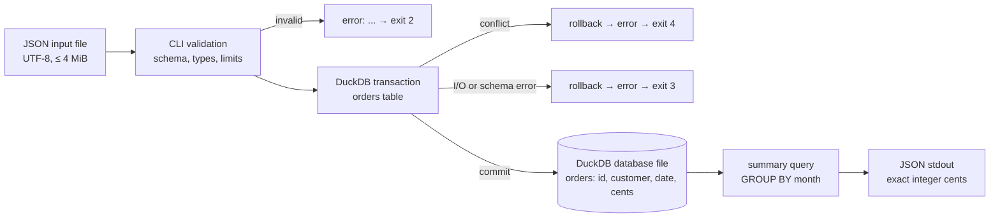

# local-sales-warehouse

A small, local sales analytics warehouse. It imports a JSON array of orders
into a real [DuckDB](https://duckdb.org/) database and reports exact monthly
totals: number of orders, distinct customers and the sum of `cents`.

- **Product version:** 0.1.0
- **Specification:** local-sales-warehouse v0.1.4 (original idea #54,
  "Local Data Lakehouse with dbt + DuckDB", reduced to the CLI-only scope)
- **Platform:** POSIX only — Ubuntu and macOS. Native Windows is out of scope.
- **Runtime:** Python 3.12, DuckDB 1.4.3 pinned in `requirements.txt`.
  No network access, extensions, dbt, Parquet, server or third-party services
  at runtime.

## Problem and scope

Small shops keep sales in flat files and need trustworthy monthly numbers
without running a cloud warehouse. This project is deliberately narrow:

- `load` validates an entire JSON file, then atomically imports it into a
  DuckDB table. Re-importing the same file is a no-op; changing an existing
  order is a conflict and rolls the whole batch back.
- `summary` groups orders by calendar month and produces exact integer sums
  (no floating point), optionally for a single month.

Out of scope: arbitrary SQL, remote e-commerce integrations, HTTP servers,
dbt pipelines, Parquet files and multi-writer concurrency.

## Quickstart

Requires Python 3.12. Run from the repository root in a POSIX shell.
The new checked-in `fixtures/orders.json` contains two fictitious orders.
Start with no `sales-example.duckdb` file; the load creates it. Preparation
installs the pinned DuckDB dependency (network only during setup); its
environment-specific output is saved in `setup.log`. Stop if setup fails.
The last command demonstrates an invalid month (exit 2).

```console
$ python setup > setup.log 2>&1
$ cat fixtures/orders.json
[{"id":"o1","customer":"c1","date":"2026-01-01","cents":100},{"id":"o2","customer":"c2","date":"2026-01-15","cents":250}]
$ python app load fixtures/orders.json --db sales-example.duckdb
{"inserted":2,"unchanged":0}
$ python app summary --db sales-example.duckdb
{"months":[{"month":"2026-01","orders":2,"customers":2,"cents":"350"}]}
$ python app summary --db sales-example.duckdb --month 2026-13
error: invalid month, expected YYYY-MM
$ echo $?
2
```

## CLI

```
usage: app <command> [options]

Commands:
  load INPUT --db DB              Import orders from a JSON array into DB.
  summary --db DB [--month YYYY-MM]
                                  Report per-month totals from DB.

Options:
  --db DB        Path to the DuckDB database file (required).
  --month YYYY-MM
                 Month filter for summary, 0001-01 through 9999-12.
  --help         Show help and exit.
  --version      Print "local-sales-warehouse 0.1.0" and exit.
```

- On success stdout contains exactly one JSON document on one line, followed
  by a single LF; stderr is empty.
- On error stdout is empty and stderr is one line starting with `error:`,
  without a traceback. Exit codes: `2` invalid input/usage, `3` I/O or
  database error, `4` conflicting order id.
- `--version` prints exactly `local-sales-warehouse 0.1.0` and exits 0.
  `--help` exits 0 and documents every command and option.

### Input format

```json
[
  {"id": "o1", "customer": "c1", "date": "2026-01-01", "cents": 100}
]
```

| Rule | Limit |
| --- | --- |
| File size | up to and including 4 MiB (4194304 bytes) |
| Orders per file | up to and including 10000 |
| `id`, `customer` | ASCII `[A-Za-z0-9_-]{1,32}`, unique `id` within the file |
| `date` | exact Gregorian `YYYY-MM-DD`, `0001-01-01`..`9999-12-31` |
| `cents` | strict integer, `0`..`9007199254740991` |
| Object keys | exactly `id`, `customer`, `date`, `cents` |

UTF-8 without BOM. NaN/Infinity, duplicate keys, extra fields, booleans,
decimals and repeated ids are rejected with exit 2 before any database
mutation. The input file is never modified.

### Database model

The public table is real DuckDB data, inspectable with the public DuckDB API:

```sql
CREATE TABLE orders (
    id VARCHAR PRIMARY KEY,
    customer VARCHAR NOT NULL,
    date DATE NOT NULL,
    cents HUGEINT NOT NULL
);
```

`load` creates the database (with an existing parent directory) and table when
missing. Every batch runs in one DuckDB transaction: validation and the
accumulated-order limit (`10^9`) are checked before commit, and any conflict or
storage error rolls the batch back. `summary` opens the database read-only,
never creates one, and rejects corrupt or incompatible databases with exit 3.

The contractual accumulated limit of 10^9 orders per database is enforced
before commit but is not exercised by the public tests (materializing 10^9 rows
is out of scope); it remains subject to inspection.

## Architecture



## Tests and lint

All public tests are black-box: they drive `app` as a subprocess and inspect
the database through the public DuckDB API. No implementation module is
imported. Each test uses its own temporary directory, database and process.

```sh
./setup
PYTHONUTF8=1 .venv/bin/python -m unittest discover -s tests -v
```

Lint and format checks (tool pinned in `requirements-dev.txt`):

```sh
.venv/bin/python -m pip install --requirement requirements-dev.txt
.venv/bin/ruff check app setup tests .
.venv/bin/ruff format --check app setup tests .
```

CI runs lint and the test suite on `ubuntu-latest` and `macos-latest` with
Python 3.12 and `PYTHONUTF8=1` (`.github/workflows/ci.yml`).

### Acceptance-criteria traceability

| AC | Public test |
| --- | --- |
| AC-1 | `LoadTests.test_ac1_load_creates_real_duckdb_table` |
| AC-2 | `LoadTests.test_ac2_repeating_file_is_idempotent` |
| AC-3 | `LoadTests.test_ac3_conflict_rolls_back_whole_batch`, `test_id_conflict_on_date_or_cents` |
| AC-4 | `SummaryTests.test_ac4_monthly_grouping_and_distinct_customers` |
| AC-5 | `SummaryTests.test_ac5_month_filter`, `ValidationTests.test_invalid_month` |
| AC-6 | `SummaryTests.test_ac6_maximum_cents_sum_is_exact_decimal_string` |
| AC-7 | `ValidationTests.test_ac7_cents_validation` |
| AC-8 | `ValidationTests` (dates, repeated ids, fields, document shape, raw JSON, BOM, size), `LoadTests.test_key_order_and_unicode_escapes_are_not_criteria` |
| AC-9 | `LoadTests.test_ac9_restart_and_empty_array`, `DurabilityTests` |
| AC-10 | `FailureAndAtomicityTests.test_ac10_summary_without_database_exits_3_and_creates_nothing` |
| AC-11 | `FailureAndAtomicityTests.test_ac11_*`, `test_external_lock_*`, `test_incompatible_orders_table_*` |
| AC-12 | `FailureAndAtomicityTests.test_ac12_storage_failure_*`, `test_ac12_lock_failure_*` |
| AC-13 | `LoadTests.test_ac13_paths_with_spaces_and_unicode` |
| AC-14 | `LoadTests.test_ac14_zero_cents_is_accepted_and_rendered_as_zero`, `test_order_limits_at_and_above_boundaries` |

`tests/AMBIGUIDADES.md` maps the normative audit resolutions to these tests.

### Write-failure fixture

AC-12 needs a portable, externally simulated storage failure without patching
implementation internals. Two black-box fixtures are used:

1. An external DuckDB connection held in a separate process (portable lock
   conflict), driven through the real CLI.
2. A database inside a directory made read-only with `chmod`. The test skips
   with a documented justification when the process runs as root or the
   filesystem does not enforce directory permissions.

Both verify that previously committed rows survive and that no partial batch
is visible.

## Decisions

- **DuckDB only, pinned.** `duckdb==1.4.3` is the sole runtime dependency; no
  extensions or network at runtime.
- **Exact integers.** `cents` is `HUGEINT` (signed 128-bit), sums are computed
  by DuckDB and printed as Python arbitrary-precision integers rendered as
  decimal strings; values never pass through float.
- **Atomic batches.** The whole file is validated first, then one transaction
  performs conflict detection, the accumulated-count guard and the inserts.
  Conflicts are reported per id, never partially applied.
- **Read-only summary.** `summary` connects read-only so it cannot create or
  modify a database; missing/corrupt/incompatible databases exit 3.
- **Strict schema check.** Existing `orders` tables are compared column by
  column (names, types, nullability, single-column primary key); incompatible
  tables are rejected instead of migrated.
- **Prepared environment.** `./setup` creates `.venv` idempotently and installs
  the pinned manifest; the entrypoint re-execs through `.venv` so `./app` and
  `python app` behave identically.
- **Stdlib tests.** Black-box tests use `unittest` only; the sole pinned dev
  dependency is `ruff` for lint/format.
- **No HTTP.** This product exposes a CLI only; the specification's generic
  HTTP conventions do not add a server here.

## How this was built

Authorship and process, recorded honestly and without claiming evidence that
does not exist:

- **Specification:** local-sales-warehouse v0.1.4 (13/11/2026), product
  version 0.1.0, supplied as the GitHub issue for this repository. Spec and
  product versions are intentionally distinct.
- **Implementation:** written by an AI coding agent (Claude Code harness) in
  this repository. The harness reported the model as `deepseek-flash` for this
  run. No human-authored code was supplied for this implementation.
- **Public tests:** `tests/` was written by the same implementing agent, from
  the specification, as a distinct stage after the behaviour was defined. It
  is not an independent test suite.
- **Independent evaluation:** the specification calls for hidden black-box
  tests authored by an independent AI agent of a different model family. Those
  tests are external to this clone and were not read or executed here; no
  verdict from them is claimed.
- **Human participation:** none was observed by the agent during this run. The
  maintainer records actual human corrections and participation separately;
  this file does not invent them.
- **Stage separation:** specification → implementation → public tests. Tag and
  release v0.1.0 are the maintainer's responsibility after merge; this
  repository contains no tag, publication or external submission.

## License

MIT, 2026 — see [LICENSE](LICENSE).
